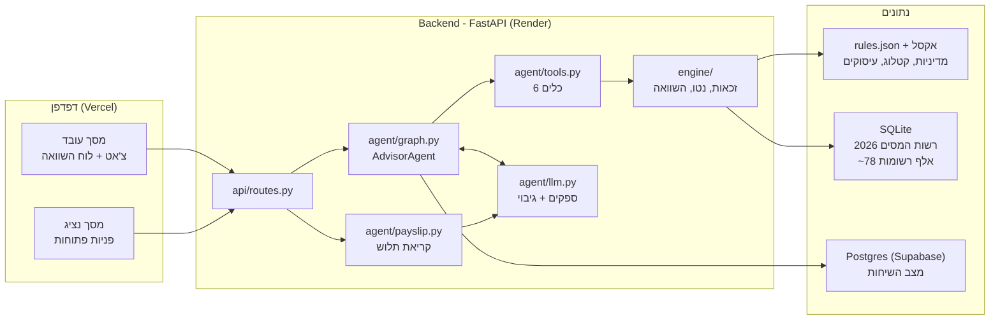
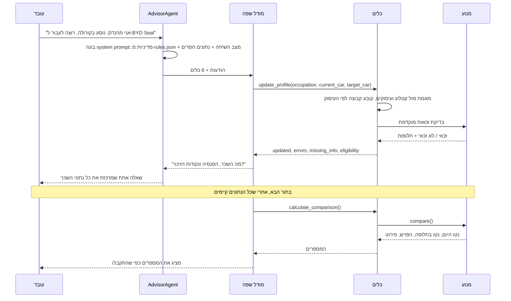
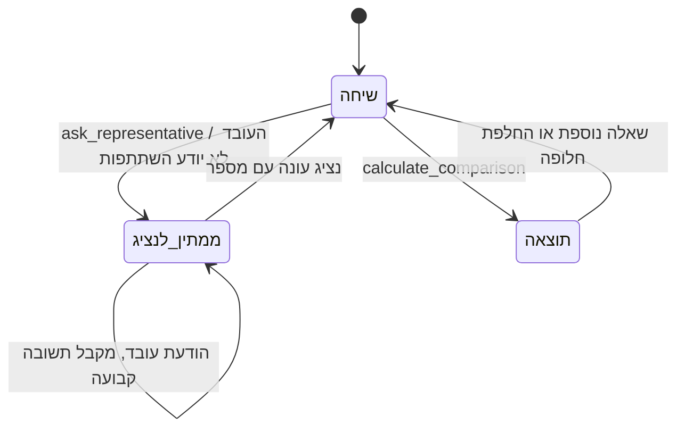
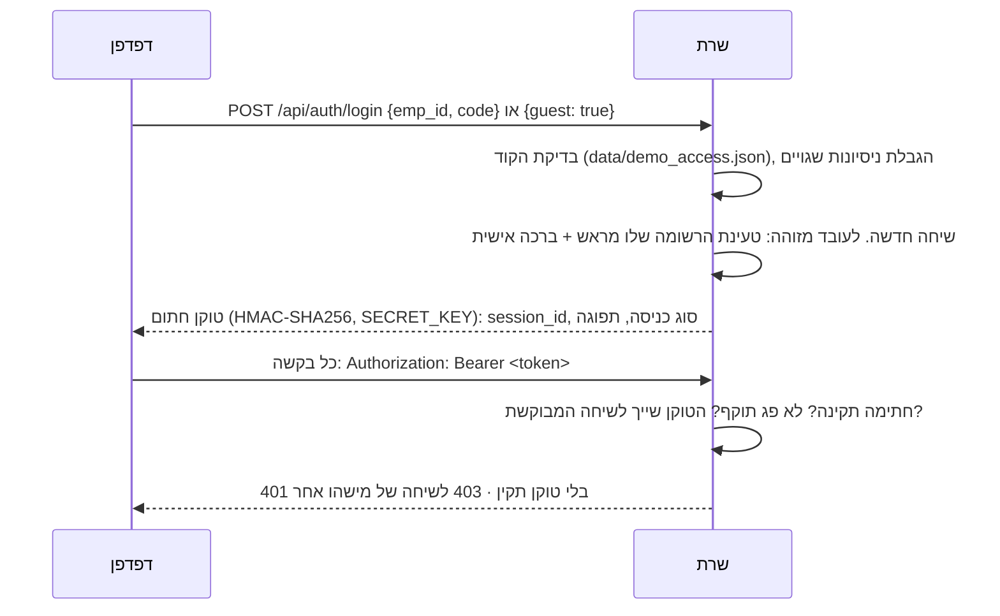
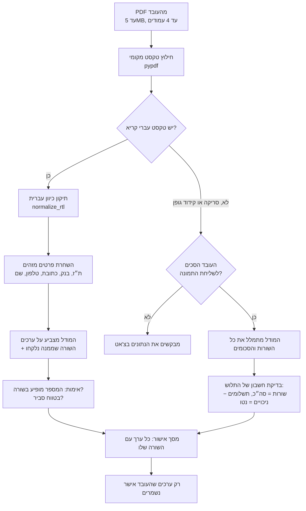

# ארכיטקטורה: יועץ הרכב של שטראוס

## בקצרה

מודל השפה מנהל את השיחה, וקוד דטרמיניסטי מחליט ומחשב. המודל לא מחשב אף מספר ולא קובע זכאות. הוא מבין מה העובד אמר, שומר את הנתונים דרך כלים, ומציג את מה שהכלים החזירו. כל שקל שמוצג לעובד מגיע ממנוע החישוב, וכל כלל מדיניות נקרא מ-`data/rules.json`.

## תמונה כללית

## חלוקת האחריות

| מי | מה הוא עושה | מה אסור לו |
|---|---|---|
| מודל השפה | מבין עברית חופשית, מחליט איזה כלי להפעיל, מנסח תשובה | לחשב, לקבוע זכאות, להמציא שווי שימוש או השתתפות |
| כלים (`tools.py`) | מאמתים כל ערך מול הקטלוג והעיסוקים, דוחים ערכים לא מוכרים, בודקים זכאות | לנחש ערך חסר |
| מנוע (`engine/`) | מחשב מס הכנסה, ביטוח לאומי ומס בריאות, שווי שימוש, החזר לרכב חשמלי ומסלול משפחה | - |
| נציג/ת שכר | מספק/ת נתון רשמי שאין במערכת (השתתפות חריגה) | - |
| העובד | מאשר כל ערך שנקרא מהתלוש לפני שהוא נשמר | - |

הסיבה לחלוקה הזו: מודלי שפה טועים בחשבון ונוטים להשלים פערים בניחוש. בתחום של שכר נטו, טעות של עשרות שקלים פוגעת באמון. לכן המודל עושה רק את מה שהוא טוב בו, כלומר שפה.

## מהלך של תור שיחה

הלולאה נמצאת ב-`AdvisorAgent._run_turn` (`backend/agent/graph.py`). בכל תור יש עד 8 סבבים של קריאה לכלים. ה-system prompt נבנה מחדש בכל סבב, כך שהמודל תמיד רואה את המצב העדכני ואת רשימת הנתונים החסרים כפי שהקוד חישב אותה (`compute_missing` ב-`state.py`).

## הכלים

| כלי | תפקיד |
|---|---|
| `update_profile` | שומר רק ערכים שהעובד אמר במפורש. רכב או עיסוק שלא בקטלוג נדחים עם הודעת שגיאה. קבוצת הזכאות נקבעת לפי העיסוק, לא לפי מה שהמודל שולח. מפעיל בדיקת זכאות מוקדמת |
| `get_allowed_cars` | רשימת הרכבים המותרים, מסלול משפחה וויתור, לפי המנוע |
| `calculate_comparison` | מסרב לרוץ כל עוד חסר נתון. מחזיר את המספרים ואת מקור ההשתתפות (קטלוג החברה או נציג) |
| `rank_alternatives` | "כל האפשרויות שלי": מחשב במנוע את הנטו לכל רכב מותר, למסלול ברוכת ילדים (אם זכאי) ולוויתור (אם מותר), ומדרג מהמשתלם ביותר. לא משנה את מצב השיחה. ההשתתפות בכל חלופה לפי הקטלוג |
| `ask_representative` | מקפיא את השיחה עד לתשובת נציג |
| `start_new_case` | מאפס תרחיש כשהעובד עובר לשאול על מצב אחר, כדי שנתונים לא יעברו בין תרחישים |

## איך המערכת נמנעת מהמצאות

| סיכון | המנגנון | איפה בקוד |
|---|---|---|
| המודל מחשב לבד ומתבלבל | כל מספר מגיע מתוצאת כלי. גם חישוב פשוט כמו 50% מהפער במסלול משפחה מחושב במנוע ומוחזר למודל | `eligibility_precheck` ב-`tools.py`, `prompts.py` |
| המודל "מזהה" רכב שלא קיים | `resolve_car` מחפש בקטלוג ובקובץ כינויים. אם לא נמצא, הכלי מחזיר שגיאה עם רשימת הרכבים | `update_profile` |
| המודל שולח את קבוצת הרכב בתור קבוצת העובד | הקבוצה נגזרת מהעיסוק. ערך סותר נדחה עם הסבר | `update_profile` |
| חישוב עם נתון חסר | `calculate_comparison` מחזיר `ok: false` ואת רשימת החסרים | `tools.py` |
| העובד לא יודע מה ההשתתפות שלו, והמודל מציב ברירת מחדל | זיהוי בביטוי רגולרי ופתיחת פנייה לנציג בקוד. ההחלטה לא נשארת למודל, ואין ברירת מחדל | `participation_unknown_field` ב-`state.py`, `_escalate_unknown_participation` ב-`graph.py` |
| בקשה שאינה אפשרית | בדיקת זכאות לפני שמבקשים נתוני שכר. העובד מקבל את הסיבה ועד 4 חלופות מותרות | `eligibility_precheck` |
| ערך מתרחיש קודם נכנס לתרחיש חדש | שינוי עיסוק או `start_new_case` מאפסים את התרחיש. ההיסטוריה שלפני האיפוס לא נשלחת למודל | `reset_case`, `llm_transcript` |
| מספר שגוי מתלוש השכר | כל מספר שהמודל מחזיר חייב להופיע בתלוש, בשורה שהוא ציטט. אחרת הוא נזרק ומוצג לעובד כ"נדחה" | `verify` ב-`payslip.py` |
| הסבר מדיניות לא נכון | עובדות המדיניות שהמודל רשאי לצטט נוצרות מ-`rules.json` בכל תור | `rules_brief` ב-`prompts.py` |

## העברה לנציג

1. הכלי מסמן את השיחה `waiting_for_rep` ושומר את השאלה ואת השדה החסר.
2. השיחה מופיעה במסך הנציג (`GET /api/rep/tickets`) עם פרטי העובד, הרכבים וההודעה האחרונה.
3. כל עוד אין תשובה, הודעות של העובד לא מגיעות למודל. העובד מקבל תשובה קבועה שהשאלה ממתינה.
4. הנציג עונה. הקוד מחלץ את המספר מהתשובה, מציב אותו בשדה ומפעיל מחדש את לולאת השיחה. אם כל הנתונים קיימים, העובד מקבל את החישוב בלי לשאול שוב.

מסך הנציג מוגן במפתח (`REP_API_KEY`, בכותרת `X-Rep-Token`), שנבדק בהשוואה בזמן קבוע (`hmac.compare_digest`). אם המפתח לא הוגדר, המסך סגור.

## כניסה ואבטחת השיחות

- **טעינה מראש:** עובד שנכנס עם מספר עובד מקבל שיחה שבה כבר נמצאים העיסוק, הקבוצה, השכר, ההפרשות, נקודות הזיכוי והרכב הנוכחי. הבוט שואל רק מה החלופה המבוקשת.
- **אורח:** שיחה ריקה. מתאימה לתסריט מהמסמך, שבו העובד מוסר את הנתונים בעצמו.
- **הטוקן נשמר ב-`sessionStorage`:** רענון הדף משאיר את העובד בשיחה, וסגירת הלשונית מנתקת אותו.
- **כל נקודות הקצה של שיחה דורשות טוקן:** הודעות, קריאת השיחה, החלופות המותרות, הדירוג, ההחלפה המהירה והתלוש. לכן מי שיודע מזהה של שיחה לא יכול לקרוא אותה.
- **ניחוש קודים:** אחרי 5 קודים שגויים, מספר העובד ננעל ל-5 דקות. ההודעה זהה למספר עובד לא קיים ולקוד שגוי.
- **הקוד של עובדי הדמו (1234) אינו סוד:** הוא מוצג לשופטים במסך הכניסה. בפיילוט מחליפים את הכניסה הזו ב-SSO הארגוני, והנתונים נטענים ממערכת השכר.

## קריאת תלוש שכר

הקובץ לא נשמר בשום שלב. סכום העמלות והבונוסים מחושב בקוד, לא במודל.

## עמידות בענן

| מצב | מה קורה |
|---|---|
| ספק המודל נכשל (מכסה, קרדיט, תקלה) | `FailoverLLM` עובר לספק הבא: `LLM_PROVIDER_2` עד `_5`. ספק שנכשל מושבת לזמן קצוב |
| כל הספקים נכשלו | `LLM_FALLBACK=rules`: מוח דטרמיניסטי ממשיך את השיחה באותו פרוטוקול כלים, והעובד רואה הודעה על כך. `none`: העובד מקבל הודעה ברורה על הסיבה (503) |
| שתי בקשות על אותה שיחה במקביל | נעילה לכל שיחה (`SessionLocks`) |
| השרת מתאתחל | השיחות שמורות ב-Postgres (כש-`DATABASE_URL` מוגדר) |
| השרת "ישן" (תוכנית חינמית) | הצד הקדמי מנסה להתחבר שוב כל 5 שניות, עד כ-75 שניות, ומציג הודעת "מתחברים" |
| מסלולי דמו, החלפה מהירה בין חלופות ו"כל האפשרויות שלי" | רצים בלי מודל שפה בכלל, ישירות מול המנוע |

## החלטות תכנון

**לולאת כלים שנכתבה ידנית, בלי LangGraph.** הזרימה פשוטה: מודל, כלים, וחוזר חלילה. יש לה שני חריגים שחייבים להיות דטרמיניסטיים: הקפאה לנציג ואיפוס תרחיש. בקוד ישיר קל לאכוף אותם, לבדוק אותם ולהסביר אותם. השם `graph.py` לא מעיד על שימוש ב-LangGraph.

**המנוע לא תלוי במודל.** אפשר להריץ את כל הבדיקות בלי מודל שפה (`RuleBasedLLM`), והמנוע נבדק מול 6 החישובים לדוגמה של האתגר בכל 9 העמודות.

**המדיניות בקובץ נתונים.** תקציבים, קבוצות, מסלול משפחה, ויתור ושיטת הנטו נקראים מ-`rules.json` ומהאקסל. החלפת הקובץ משנה גם את החישוב וגם את מה שהיועץ מסביר, בלי שינוי קוד.

**ממשק אחיד לספקי מודלים.** שכבה אחת (`llm.py`) מדברת עם Gemini, OpenAI, Anthropic, Groq, OpenRouter, Ollama וכל שרת תואם OpenAI. כך אפשר להחליף ספק או להוסיף גיבוי במשתנה סביבה.

## בדיקות

| שלב | מה נבדק |
|---|---|
| 1 - נתונים | 77,988 רשומות רשות המסים; כל רכב בקטלוג נמצא לפי המפתח הרשמי ושווי השימוש תואם |
| 2 - מחשבון | 6 עובדי הדוגמה תואמים בכל העמודות; החזר חשמלי 250 ₪ נטו בדיוק; מקרי זכאות |
| 3 - סוכן | חילוץ שדות, דחיית רכבים לא מוכרים, בדיקה מוקדמת, קבוצה לפי עיסוק, מספרי מסלול משפחה מהמנוע |
| 4 - API | כל נקודות הקצה, כולל הגנת מסך הנציג |
| 5 - תלושים | תלושים סינתטיים: טקסט רגיל, קידוד גופן, סריקה |
| Frontend | רכיבי הצ'אט, לוח ההשוואה ומסך האישור של התלוש; בדיקת אינטגרציה מול שרת אמיתי |

## מגבלות ידועות

- הנעילה לכל שיחה פועלת בתוך תהליך אחד, ולכן השרת צריך לרוץ עם worker יחיד (ברירת המחדל).
- קריאת תלוש סרוק דורשת מודל שתומך בתמונות.
- הזיהוי של "אני לא יודע את ההשתתפות" מבוסס ביטוי רגולרי, וניסוח חריג עלול לא להיתפס. במקרה כזה ההנחיה למודל עדיין אוסרת עליו להציב ברירת מחדל.
